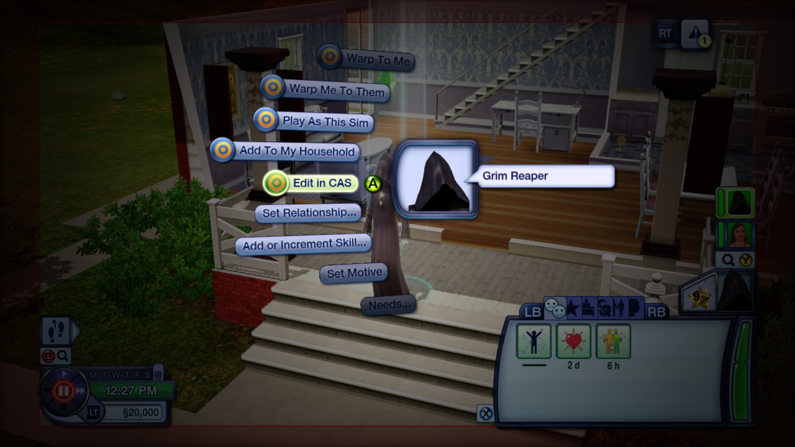
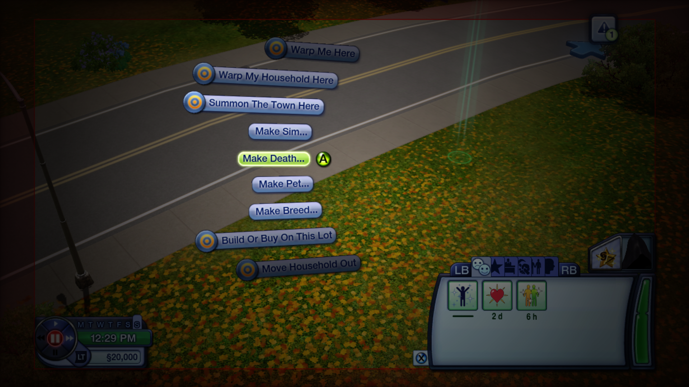
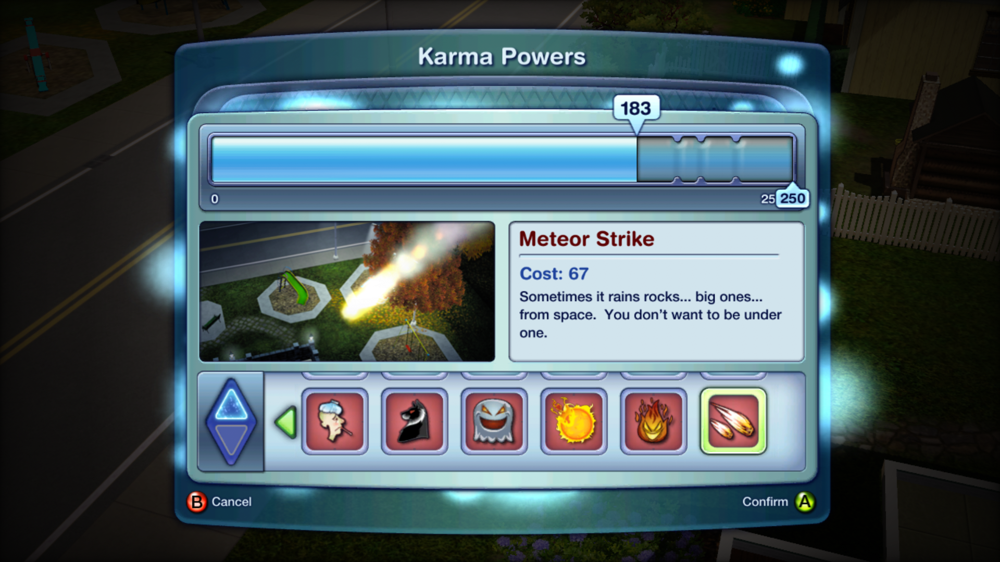
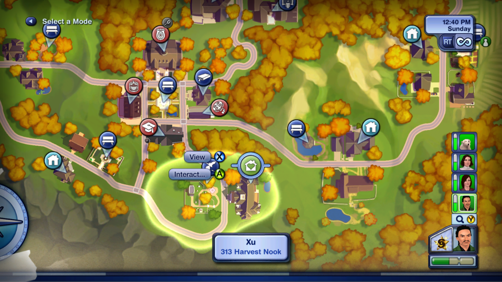
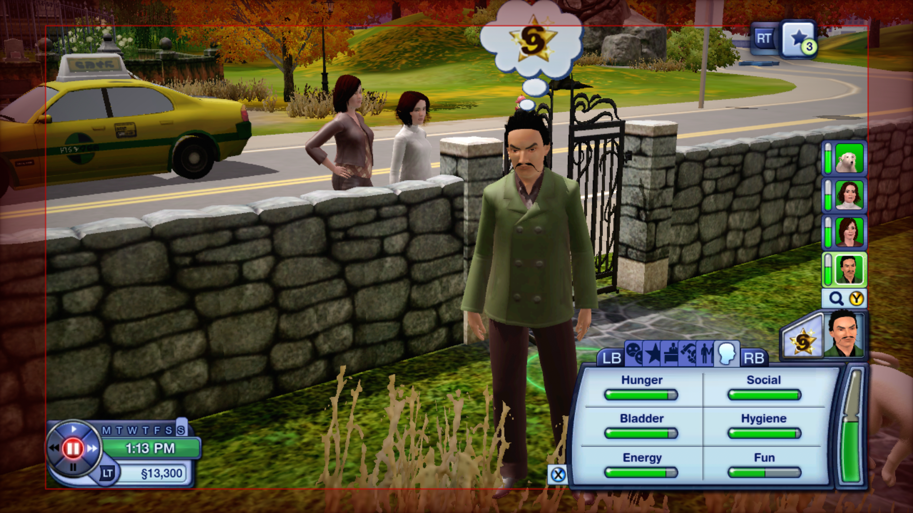
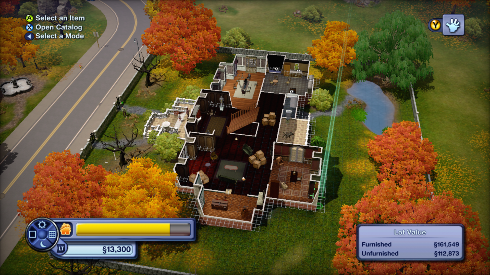

# Sims 3 Pets Xbox 360 mod menu

An in-game mod menu for **The Sims 3 Pets** on Xbox 360, played in the [Xenia Canary](https://github.com/xenia-canary/xenia-canary) emulator, plus the fixes for that game's crashes and garbled textures.

You need your own copy of the game. No game files are included here.

## This build

| | |
|---|---|
| Created | 10 November 2026, 02:35 UTC |
| Xenia Canary branch | [`canary_experimental`](https://github.com/xenia-canary/xenia-canary/tree/canary_experimental) |
| Xenia Canary commit | [`cf206a3bd`](https://github.com/xenia-canary/xenia-canary/releases/tag/cf206a3) |
| Build date in Xenia's log | Nov 8 2026 |
| `xenia_canary.exe` SHA-256 | `1A2C17275A7BEC1939BEC523FC512CE244E27213D2E0CC680E03A231A5DDB3FF` |
| Renderer | Direct3D 12, RTV/DSV render target path |
| Xenia settings | [config/xenia-canary.config.toml](config/xenia-canary.config.toml), every setting, with the profile ID removed |
| Game | The Sims 3 Pets, title ID `45410962`, version `0.0.0.3` |

## Fix the crashes and garbled textures

1. Back up your Xenia folder.
2. Download `xenia_canary_windows.7z` from the [cf206a3 release](https://github.com/xenia-canary/xenia-canary/releases/tag/cf206a3) and replace your `xenia_canary.exe` with the new one.
3. Open `xenia-canary.config.toml`, next to the exe, and set these under `[GPU]`:

   ```toml
   async_shader_compilation = false
   readback_resolve = "full"
   readback_memexport = true
   ```

4. Start the game. Brief stutters are normal the first time new things appear, and they fade as shaders are cached.

Portraits saved while they were corrupted stay corrupted, so start from a save made after these changes. Leave the render target path on its default: the ROV path didn't help and made shadows worse.

### Why these work

- **Crashes:** [BorealisEcho's report](https://github.com/xenia-canary/game-compatibility/issues/135#issuecomment-6019598941) showed the two readback settings fix Sim pictures, corrupted textures and vertex explosions, but the game still crashed. Older builds could overwrite game memory with `readback_memexport` on, which [PR #1325](https://github.com/xenia-canary/xenia-canary/pull/1325) fixed. The updated build didn't crash in testing. The old build wasn't re-run for comparison, so this is the likely cause rather than a proven one.
- **Garbled portraits:** The game appears to draw each portrait once and keep it. With `async_shader_compilation` on, Xenia [skips draws whose shaders aren't ready](https://github.com/xenia-canary/xenia-canary/blob/cf206a3/src/xenia/gpu/d3d12/pipeline_cache.cc#L570), so Sims lost their hair or turned into green squares and grey bars. With it off, the same test stayed clean, even with an empty shader cache.

### Testing

Build `cf206a3` ran one 43-minute scripted session with no crash or freeze. That covered 34 Sim-switch attempts, 28 rounds of zooming, Town Map scrolling, the Build/Buy catalog, save-and-quit, Create-a-Sim and moving in a pre-made family. Atronode then played it on an Xbox 360 controller and reported it working. Other PCs weren't tested, and longer sessions could still crash.

### Related reports

- [Canary compatibility report #135](https://github.com/xenia-canary/game-compatibility/issues/135)
- [Original Xenia report #1587](https://github.com/xenia-project/game-compatibility/issues/1587)
- [PR #1325: memexport readback](https://github.com/xenia-canary/xenia-canary/pull/1325)
- [Commit 5845f3437: async shader compilation](https://github.com/xenia-canary/xenia-canary/commit/5845f3437b8c22f95d4b9daee008c7b6e58c1fd8)

## Mod menu

### Screenshots

Taken in Xenia on a copy of the saves, with the mod menu installed.

#### The Sim menu



Hold **LT** and press **A** on a Sim, here the Grim Reaper. The menu lists Warp To Me, Warp Me To Them, Play As This Sim, Add To My Household, Edit in CAS, Set Relationship, Add or Increment Skill, Set Motive and Needs. The round orange icon marks an option added by this mod. Plain pills such as Set Relationship are the game's own hidden debug options, which the mod now brings up in the normal menu. This means any Sim, even one you can't normally control, can be edited, moved or taken over from here. The funds in the corner show §20,000 after using the Money options.

#### The ground menu



The same gesture on empty ground gives world options: Warp Me Here, Warp My Household Here and Summon The Town Here (every Sim in town walks up to that spot), plus Make Sim, Make Death, Make Pet, Make Breed, Build Or Buy On This Lot and Move Household Out. This is how you move around the world, create Sims and pets, or change a lot without leaving the game.

#### Karma powers, all unlocked



The Karma Powers panel with the meter at 183 of 250 and Meteor Strike selected (cost 67). Normally these powers have to be bought with challenge points first. The launcher unlocks them every time a game loads, including the red "bad" powers such as sickness, ghosts, fire and meteors, so the Build mode challenge step is no longer needed.

#### Households the game doesn't let you play



On the Town Map, the Xu household at 313 Harvest Nook is selected with the View and Interact options. The portraits on the right are that household's members. Households like this normally can't be played. With the mod, Play This Household and Play As This Sim take you into them.



The result: the player is now controlling a Sim from the Xu household, shown in the portrait list and the Sim panel at the bottom right. Funds are §13,300, that household's own money.



Build mode on a large, dark house with a pond, showing its Lot Value (§161,549 furnished). This is a lot the game normally keeps closed to players. With the mod you can enter its lot and use Build Or Buy On This Lot to look around or change it.

### Set it up

1. Apply the fixes above.
2. Download this repository (**Code**, then **Download ZIP**) and unzip it.
3. Put the `mod-menu` folder next to your `xenia` folder and your game's `.iso` file. The file's name must include Sims, 3 and Pets.

```text
Any folder
├── xenia                 (holds xenia_canary.exe)
├── The Sims 3 Pets.iso
└── mod-menu
```

### Play with it

1. Close Xenia if it's open.
2. Double-click **Play Sims 3 Pets (Mod Menu).bat** in the `mod-menu` folder.
3. The game opens along with a small black window. Leave that window open while you play. It closes when the game does.
4. Load your save. All challenge rewards, including the karma powers, unlock each time a game loads.

Always start the game this way. If you open the game straight from Xenia, there's no menu.

### Open the menu

Hold **LT** and press **A** while pointing at a Sim, a pet, the ground or an object. Press **B** to go back, and push the stick up or down to scroll.

| Pointing at | Options |
|---|---|
| A Sim | Warp To Me, Warp Me To Them, Play As This Sim, Add To My Household, Edit in CAS, Set Relationship, Add or Increment Skill, Set Motive, Needs, Age, Traits & Wishes, Career, Family, Die By, Force Reset, Money, Time |
| Age | Age Up, Age Down (one life stage younger, as far as toddler; pets go elder, adult, then young), Age Up Tomorrow |
| Traits & Wishes | Change Traits (the game's own trait picker), Add Random Trait, Complete Lifetime Wish |
| The ground | Warp Me Here, Warp My Household Here, Summon The Town Here, Make Sim, Make Pet, Make Breed, Add Fire, Add Puddle, Add Trash Pile, Build Or Buy On This Lot, Move Household Out, Bulldoze This Lot, Spawn Rocks And Gems, Money, Time |
| An object | Clone, Delete It, Add To Family Inventory |
| A house on the map | Play This Household, Repair All Objects, Move Household In or Out, Add To Household |
| A mailbox | AutoPay Bills, Make Everything Unbreakable, Unlock All Lots, Relics, Mystery Rewards and Challenges |
| Anything | Developer Tools, which holds all the game's leftover test options |

Some options change your save for good once you save, such as Die By, Bulldoze, Move Household Out and Delete It. Back up your saves first. Developer Tools are the game's unfinished test options, so a few may do nothing or misbehave.

### What has been tested

All testing used copies of the saves.

| Tested and working | Not tested yet |
|---|---|
| Menus on a Sim, a pet and the ground | Play As on a Sim from a different family |
| Developer Tools folder | Age Down at stages other than adult to young adult |
| Warp Me Here, Warp My Household Here, Summon The Town Here | Add Random Trait, Complete Lifetime Wish |
| Money, Time | Career and Family options |
| Play As on a Sim in the same household | Add To My Household |
| Karma powers unlocking | House and mailbox menus |
| Age Up, Age Down from adult to young adult | Clone and Delete It |
| Change Traits opening and selecting a trait | Going below young adult with Age Down, which leaves adult jobs and partners in place |

### How it works

The launcher starts Xenia, waits for the game to load its script code, then writes small changes into the game's memory. Before changing anything, it checks each location against a SHA-256 hash, and if your copy doesn't match, it leaves the game alone. Nothing on disk changes: your game file, Xenia and your saves stay as they are.

## How this was made

The mod menu was made with [Claude Code](https://claude.com/claude-code), Anthropic's AI coding agent, running Claude Opus 5.5, with Atronode directing the work and playing the results. Claude Code handled the workflow:

1. Read the game's script code from memory while it ran in Xenia, and traced how its hidden debug menu opens.
2. Wrote the patch generator in [`tools`](tools) and the launcher in [`mod-menu`](mod-menu).
3. Played the game in Xenia with scripted controller input, on copies of the saves, and checked each option from screenshots.
4. Researched and tested the Xenia crash and texture fixes above.

## Notes

This is a fan project. It isn't affiliated with or endorsed by Electronic Arts, Maxis or the Xenia project. The Sims is a trademark of Electronic Arts. Use it at your own risk.
